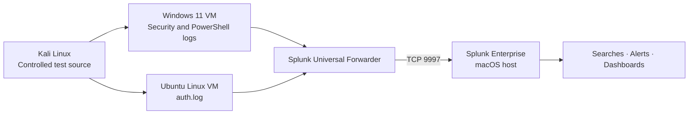

# SOC Detection, Investigation & Incident Response Platform

A hands-on Security Operations Center (SOC) lab built to practise endpoint log collection, threat detection, alert validation, investigation, and basic incident response using Splunk.

The project uses controlled security simulations in isolated virtual machines. Each scenario documents the activity, relevant telemetry, Splunk detection logic, investigation findings, and response or cleanup actions.

## Project Overview

The lab demonstrates an end-to-end detection workflow:

1. Generate a controlled security event in a lab endpoint.
2. Collect endpoint logs with Splunk Universal Forwarder.
3. Search and analyse events in Splunk Enterprise.
4. Build and validate detection searches and scheduled alerts.
5. Investigate related activity and assess the evidence.
6. Document findings, limitations, and remediation.

## Lab Architecture

| Component | Role |
|---|---|
| macOS host | Runs Splunk Enterprise |
| Windows 11 VM | Windows endpoint for security-event monitoring and detection tests |
| Ubuntu Linux VM | Linux endpoint for authentication and sudo activity monitoring |
| Kali Linux VM | Source system for controlled security simulations |
| Splunk Universal Forwarder | Collects and forwards endpoint logs to Splunk |
| Splunk Enterprise | Central log search, detection, alerting, and dashboard platform |

## Technology Stack

- **SIEM:** Splunk Enterprise 10.6.1.1
- **Log collection:** Splunk Universal Forwarder
- **Endpoints:** Windows 11 Home ARM and Ubuntu Linux
- **Test system:** Kali Linux
- **Detection language:** Splunk Processing Language (SPL)
- **Windows telemetry:** Security, PowerShell Operational, and Task Scheduler Operational event logs
- **Linux telemetry:** `/var/log/auth.log`
- **Threat framework:** MITRE ATT&CK

## Detection Scenarios

The following scenarios were tested in the lab and documented individually.

| # | Scenario | Key telemetry | MITRE ATT&CK |
|---:|---|---|---|
| 1 | [Windows SMB Brute-Force Detection](./SMB-Brute-force.md) | Windows Security Event ID 4625 | T1110.001 — Password Guessing |
| 2 | [Linux SSH Brute-Force Detection](./Linux-SSH-Brute-force.md) | Ubuntu `auth.log` failed-password events | T1110.001 — Password Guessing |
| 3 | [Linux Sudo Privilege Escalation](./Linux-Sudo-Privilege-Escalation.md) | Ubuntu sudo activity in `auth.log` | T1548.003 — Sudo and Sudo Caching |
| 4 | [Windows Local Account and Administrators Group Changes](./Windows-Local-Account-Admin-Group-Modification.md) | Windows Security Event IDs 4720 and 4732 | T1136.001 — Create Account: Local Account; T1098.007 — Additional Local or Domain Groups |
| 5 | [Windows PowerShell Encoded Command Execution](./Windows-PowerShell-Encoded-Command-Detection.md) | Windows Event ID 4688 and PowerShell Event ID 4104 | T1059.001 — PowerShell |
| 6 | [Windows Scheduled Task Persistence](./Windows-Scheduled-Task-Persistence-Detection.md) | Windows Security Event ID 4698 and Task Scheduler Operational events | T1053.005 — Scheduled Task |

## What Was Practised

- Configuring endpoint log collection and forwarding.
- Verifying that Windows and Linux events arrive in Splunk.
- Extracting fields from raw event data with SPL.
- Grouping and correlating events to identify suspicious patterns.
- Building detection searches and scheduled alerts.
- Validating detections with controlled test activity.
- Reviewing authentication, process, account-management, privilege, and scheduled-task evidence.
- Investigating alerts before making an incident assessment.
- Creating Splunk dashboards for monitoring.
- Removing temporary test accounts, permissions, tasks, and marker files after exercises.

## Documentation

Each scenario document records its own lab setup, test activity, telemetry, detection logic, alert validation, investigation, MITRE ATT&CK mapping, and cleanup or remediation findings.

The Splunk environment setup is documented in [`lab/splunk-setup.md`](./lab/splunk-setup.md).

## Scope and Responsible Use

This is a personal learning lab, not a production SOC deployment. All simulations were performed as authorised tests against the user's own virtual machines.

Detection thresholds and alert severities were selected for lab validation; they are not universal production recommendations. A detection alert is an investigation lead, not proof of compromise. Findings are limited to the logs and time windows recorded in each scenario.

Some exercises also document telemetry or detection limitations discovered during testing. These are retained rather than presented as completed capabilities.

## Project Status

The six documented detection scenarios have been exercised in the lab. The repository documentation describes the observed results and identifies relevant limitations where applicable.

---

**Purpose:** Demonstrate practical SOC skills in log monitoring, detection engineering, alert validation, investigation, and security documentation.
